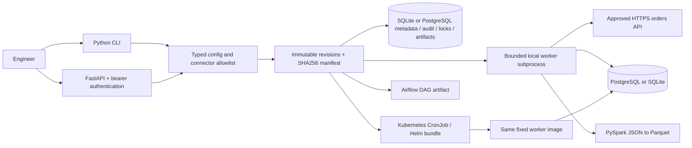
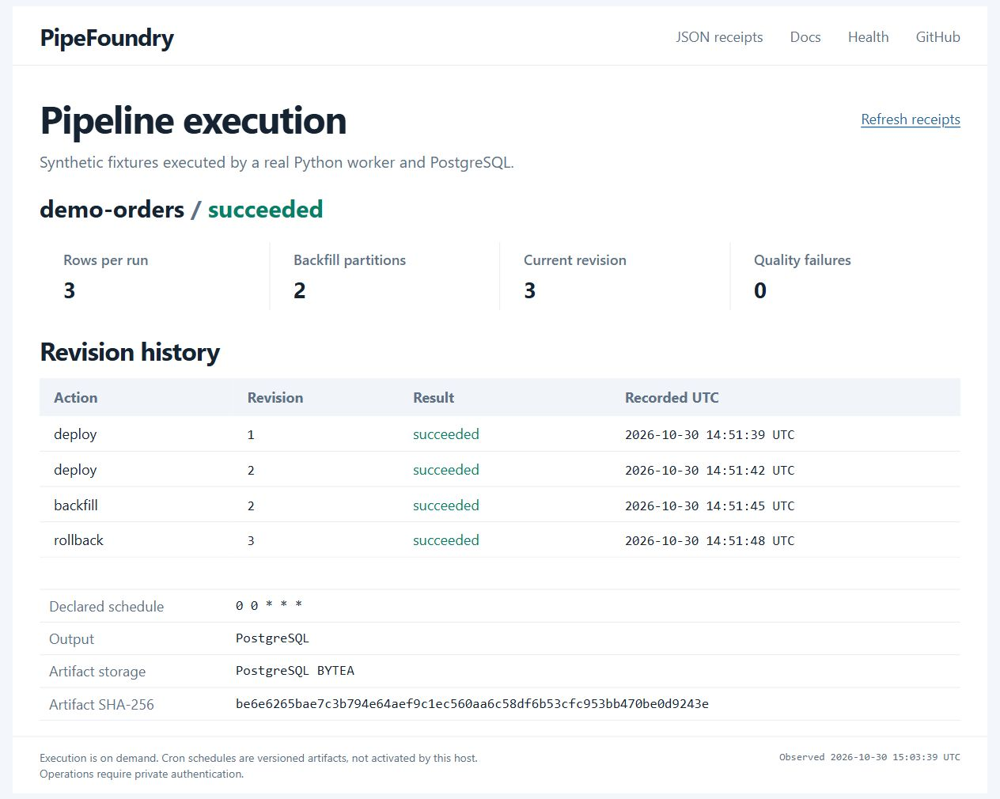

# PipeFoundry

[](https://github.com/9059Rohith/pipefoundry/actions/workflows/ci.yml)

Hosted CI is currently blocked by an account-level runner restriction. [Executed local verification](docs/verification.md) is recorded separately; no hosted pass is claimed.

**Live app:** [PipeFoundry console](https://rohith-pipefoundry.vercel.app) ·
[JSON execution receipts](https://rohith-pipefoundry.vercel.app/demo) ·
[Readiness](https://rohith-pipefoundry.vercel.app/health/ready).
The free Vercel Docker deployment uses durable Neon PostgreSQL. Its public,
read-only console shows real synthetic ingestion, SQL quality checks, two
backfills and a rollback; operations require a private bearer token. See the
[hosted runbook](docs/hosted-profile.md) and
[public verification evidence](evidence/public-release-verification.json).

A self-service data pipeline platform for the **OpenFX Data Engineering + DevOps
Intern** portfolio. Submit a bounded YAML specification, validate it, create a
versioned deployment bundle, execute the pipeline locally or apply its Kubernetes
CronJob, inspect state/logs, backfill dates, roll back configuration, and tear down
workloads while retaining an audit trail.

The local executor runs real Python child processes and writes real SQL tables.
The production ingestion connector calls an administrator-approved HTTPS API and
upserts PostgreSQL with SQL quality checks. A separate PySpark workload reads JSON,
normalizes currencies, and writes partitioned Parquet with a read-after-write check.

**Deployment claims are explicit:** `rendered` means files exist, `succeeded`
means a local worker exited successfully, and `deployed` means Kubernetes accepted
the CronJob. A CronJob's acceptance does not establish that any scheduled run
completed. See [verification evidence](docs/verification.md) for observed results
and external-runtime limits.



## Run locally

Python 3.12 is supported locally; the pinned minimal API container uses Python
3.15 and is separately tested. These commands use PowerShell; on Linux use
`.venv/bin/python` and `.venv/bin/pipefoundry`.

```powershell
python -m venv .venv
.venv\Scripts\python -m pip install -r requirements-dev.lock
.venv\Scripts\python -m pip install --no-deps -e .
.venv\Scripts\pipefoundry validate examples/orders-local.yaml
.venv\Scripts\pipefoundry deploy examples/orders-local.yaml
.venv\Scripts\pipefoundry status orders-demo
.venv\Scripts\pipefoundry logs orders-demo
.venv\Scripts\pipefoundry backfill orders-demo --start 2026-01-01 --end 2026-01-03
.venv\Scripts\pipefoundry deploy examples/orders-local.yaml
.venv\Scripts\pipefoundry rollback orders-demo --revision 1
.venv\Scripts\pipefoundry audit orders-demo
.venv\Scripts\pipefoundry teardown orders-demo
```

Use global `--state-dir PATH` **before** the subcommand to isolate state. The
default is `.pipefoundry/`. Local deployment executes one current UTC partition;
it does not start a local scheduler. Scheduling is supplied by Kubernetes or
Airflow. The fixture has three orders totaling 4,250 cents; duplicate runs for
the same date retain three rows. Backfill accepts at most 31 inclusive dates.

## Configure a pipeline

For an ephemeral container host, PostgreSQL can persist control-plane state,
artifact bytes and worker logs. The opt-in public HTML console displays real
synthetic execution, backfill and rollback receipts while private APIs retain
bearer authentication. See the [hosted profile and runbook](docs/hosted-profile.md).

```yaml
name: orders-demo
schedule: "0 * * * *"  # five fields, UTC
input:
  connector: fixture   # fixture | orders_api | spark_json
transform: normalize_orders
output:
  connector: sqlite    # sqlite | postgres | parquet
  path: orders.db
resources:
  cpu_millis: 100      # 50..4000
  memory_mib: 128      # 64..8192; Spark minimum 1024
```

Unknown fields, arbitrary URLs, scripts, SQL, container images, absolute/traversal
paths, invalid schedules, incompatible connectors and excessive resources are
rejected. Input/output paths resolve under the state directory's `data/` subtree.
Spark requires `spark_json` + `parquet`; other inputs write SQL. See
[examples](examples) and [security design](docs/security.md).

CPU/memory requests and limits are applied to Kubernetes pods. The host local
executor has a process deadline and bounded input, but is not an OS resource
sandbox; use Docker/Compose limits for stronger host isolation.

## API and Docker Compose

Generate unique local credentials in the environment. They are deliberately
required by Compose and are never checked into this repository.

```powershell
$env:POSTGRES_PASSWORD = (.venv\Scripts\python -c "import secrets; print(secrets.token_hex(24))")
$env:PIPEFOUNDRY_API_TOKEN = (.venv\Scripts\python -c "import secrets; print(secrets.token_hex(32))")
docker compose up --build -d --wait
$headers = @{Authorization = "Bearer $env:PIPEFOUNDRY_API_TOKEN"}
Invoke-RestMethod http://localhost:8094/health/ready
$config = Get-Content examples/orders-local.yaml -Raw
# Use the Python CLI to convert YAML to JSON without a PowerShell YAML dependency.
$spec = (.venv\Scripts\pipefoundry validate examples/orders-local.yaml | ConvertFrom-Json).config
$body = @{config=$spec; executor='local'} | ConvertTo-Json -Depth 8
Invoke-RestMethod http://localhost:8094/pipelines -Method Post -Headers $headers -ContentType application/json -Body $body
```

The API binds to localhost port 8094 in Compose; PostgreSQL binds localhost
55435. API requests without the correct bearer token fail. Missing or short
tokens fail closed with 503. Liveness is public; readiness checks secure token
configuration and metadata connectivity. Requests are capped at 32 KiB.

| Route | Behavior |
|---|---|
| `GET /pipelines` | Latest revision of each pipeline |
| `POST /pipelines` | Deploy `{config, executor}` |
| `POST /render` | Render a pipeline config without deployment |
| `GET /pipelines/{name}` | Latest artifact, outstanding `cluster_targets`, and live CronJob observations |
| `GET /pipelines/{name}/logs` | Bounded local logs or actual Kubernetes pod logs |
| `GET /pipelines/{name}/audit` | Ordered lifecycle audit events |
| `POST /pipelines/{name}/backfill` | `{start, end}` inclusive UTC dates |
| `POST /pipelines/{name}/rollback` | `{revision}` creates a new revision |
| `DELETE /pipelines/{name}` | Remove workloads in all recorded namespaces, retain data/revisions/audit |

For direct API development, set the token and run
`uvicorn pipefoundry.api:app --host 127.0.0.1 --port 8094 --workers 1`.
Mutations run synchronously; callers should allow five minutes per worker/date.
This single-operator control plane intentionally has no multi-tenant identity/RBAC.

## Real API → PostgreSQL ingestion

Administrators configure connectors using environment variables, rather than
allowing API callers to provide arbitrary network destinations:

```powershell
$env:PIPEFOUNDRY_ORDERS_URL = 'https://approved-api.example.com/orders'
$env:PIPEFOUNDRY_ALLOWED_HOSTS = 'approved-api.example.com'
$env:PIPEFOUNDRY_POSTGRES_DSN = "postgresql://pipefoundry:$env:POSTGRES_PASSWORD@127.0.0.1:55435/pipefoundry"
.venv\Scripts\pipefoundry deploy examples/orders-postgres.yaml
```

The endpoint must return a JSON array of `{id, amount_cents, currency}` records.
TLS verification is enabled; optional `PIPEFOUNDRY_CA_BUNDLE` supplies a private
CA PEM file. An explicitly approved nondefault HTTPS port must appear in the
allowlist as `hostname:port`. Redirects and URL credentials are forbidden.
Responses are bounded to 1 MiB / 10,000 records. Network/timeout, 429 and 5xx
errors retry at most three times with exponential delay. Other 4xx errors fail.
The database connection and statements have timeouts. Upserts use the composite
key `(partition_date, id)` and all inserts plus quality checks commit atomically.

`test_real_https_api_to_postgres_through_worker` creates an ephemeral TLS server,
injects a real 503, runs worker child processes twice and reads PostgreSQL to
prove one normalized row remains. Only that test routes to a local approved
connector and ephemeral CA. No live vendor API is required.

## PySpark JSON → Parquet

Install the optional, separately locked runtime and Java 17+:

```powershell
.venv\Scripts\python -m pip install -r requirements-spark.lock
$env:JAVA_HOME = 'C:\Program Files\Eclipse Adoptium\jdk-17.0.18.8-hotspot'
$env:PIPEFOUNDRY_TEST_SPARK = '1'
.venv\Scripts\python -m pytest -m spark -q
```

For CLI execution, place newline-delimited JSON at
`.pipefoundry/data/orders.json`, then deploy `examples/orders-spark.yaml`.
Gzip-compressed Parquet goes to `data/orders-parquet/<UTC-date>/currency=USD/` etc.
Gzip avoids Snappy's native-library extraction into a noexec temporary mount. Invalid,
missing and duplicate IDs fail quality validation. A repeated partition uses
Spark overwrite semantics; readers should coordinate with the writer. For
object storage, production requires an atomic publish/manifest protocol before
adopting this sample as a lakehouse writer. The ordinary API image excludes
Spark/Java; [Dockerfile.spark](Dockerfile.spark) supplies that workload runtime.

On this Windows host, Java's Unix-domain socket initialization prevented native
Spark startup. The acceptance workload is therefore also executed in a real Linux
container. To reuse the installed OS-independent PySpark package without a second
large download:

```powershell
docker build -f scripts/Dockerfile.spark-verify --build-context spark=.venv/Lib/site-packages/pyspark --build-context py4j=.venv/Lib/site-packages/py4j -t pipefoundry:spark-verify .
docker run --rm --memory=2g --cpus=2 --read-only --tmpfs /tmp:rw,size=512m pipefoundry:spark-verify
```

Build `pipefoundry:0.1.0` first. The verification image reuses a Java17 image and
the installed Python/JAR packages; the standalone Spark Dockerfile installs the
same pinned packages normally. See verification.md for observed results.

## Kubernetes, Helm, Airflow and AWS

`pipefoundry render examples/orders-local.yaml` creates a numbered revision with
`pipeline.json`, `bundle.yaml`, `cronjob.yaml`, a real Helm chart,
`airflow_dag.py`, and content checksums. These are concrete deployment files;
the deploy command performs the external effect only when explicitly selected:

```powershell
$env:PIPEFOUNDRY_NAMESPACE = 'pipefoundry'
$env:PIPEFOUNDRY_WORKER_IMAGE = 'your-registry/pipefoundry:0.1.0'
pipefoundry deploy examples/orders-local.yaml --executor kubernetes
pipefoundry status orders-demo
pipefoundry logs orders-demo
```

Rendering or switching to local execution does not remove an earlier cluster
deployment. Its original namespace remains in the durable target registry until
teardown successfully deletes its labelled resources, including possible partial
resources from failed applies. Later namespace environment changes do not redirect
cleanup to the wrong namespace.

The namespace, shared PVC and connector secrets must exist first. Install the
[control-plane Helm chart](infra/helm/pipefoundry), then use a trusted operator
CLI with kubectl credentials. The base API container intentionally has no cluster
credentials or kubectl. Generated workers have no Kubernetes API token, use a
non-root UID, drop all capabilities, use a read-only root filesystem, have CPU/
memory limits, and bounded ephemeral scratch storage. CronJobs forbid concurrent
runs, have deadlines, bounded retries, histories and TTL cleanup. The chart adds
API probes and NetworkPolicies. Read the [deployment runbook](docs/runbook.md)
before choosing PVC access mode, installing CSI drivers or enabling API egress.

Airflow output targets **Airflow 3.3.2** with the standard provider, using the
public `airflow.sdk` DAG interface, a fixed Python callable, UTC dates,
bounded retries, execution timeout and one active run. Airflow is an alternative
scheduler; install the package on its workers and mount persistent pipeline data.
Airflow execution is a separate acceptance test, not inferred from Python syntax.

The [Terraform modules](infra/terraform) provide a two-AZ VPC, private worker
subnets, one NAT gateway per AZ, private-only EKS API, managed nodes with IMDSv2
and encrypted disks, log retention, secret encryption, IAM cluster/node roles,
CNI IRSA and EKS access entries. Apply requires an AWS account, administrator role,
remote backend and a runner on the VPC network. No cloud resources are created by
this repository's default CI. Two NAT gateways and EKS nodes incur ongoing costs.

## Verification and design references

```powershell
.venv\Scripts\python -m pytest -q
.venv\Scripts\python -m ruff check src tests scripts
.venv\Scripts\python -m bandit -r src
.venv\Scripts\python -m pip_audit -r requirements.lock
.venv\Scripts\python scripts/benchmark.py
```

Runtime tests opt into `PIPEFOUNDRY_POSTGRES_DSN` and `PIPEFOUNDRY_TEST_SPARK=1`.
CI enables both and uploads test/scan/benchmark evidence. Benchmarks measure
validation, template construction, artifact rendering and full local execution
with actual wall-clock samples and nearest-rank p50/p95/p99; no synthetic latency
numbers or cloud SLA claims are used.

- [Architecture and ADRs](docs/architecture.md)
- [Security and threat model](docs/security.md)
- [Runbooks and failure recovery](docs/runbook.md)
- [Requirements and interview questions](docs/requirements.md)
- [Verification results and limitations](docs/verification.md)
- [Implementation plan and progress ledger](docs/superpowers/plans/2026-10-30-pipefoundry.md)

Primary references: [Kubernetes CronJobs](https://kubernetes.io/docs/concepts/workloads/controllers/cron-jobs/),
[NetworkPolicy enforcement](https://kubernetes.io/docs/concepts/services-networking/network-policies/),
[PostgreSQL ON CONFLICT](https://www.postgresql.org/docs/current/sql-insert.html),
[Spark Parquet](https://spark.apache.org/docs/4.0.1/sql-data-sources-parquet.html),
[EKS private API access](https://docs.aws.amazon.com/eks/latest/userguide/cluster-endpoint.html).


## Public deployment evidence



Captured from the actual public HTTPS deployment. [Executed public checks](evidence/public-release-verification.json) record real backend responses, authentication results and a small warm-request sample.
