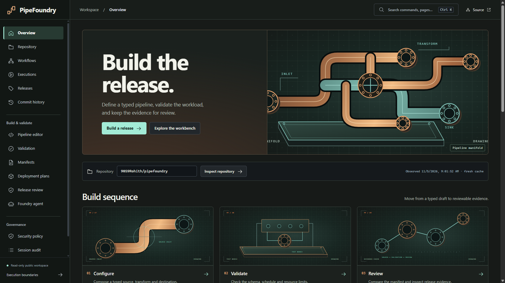
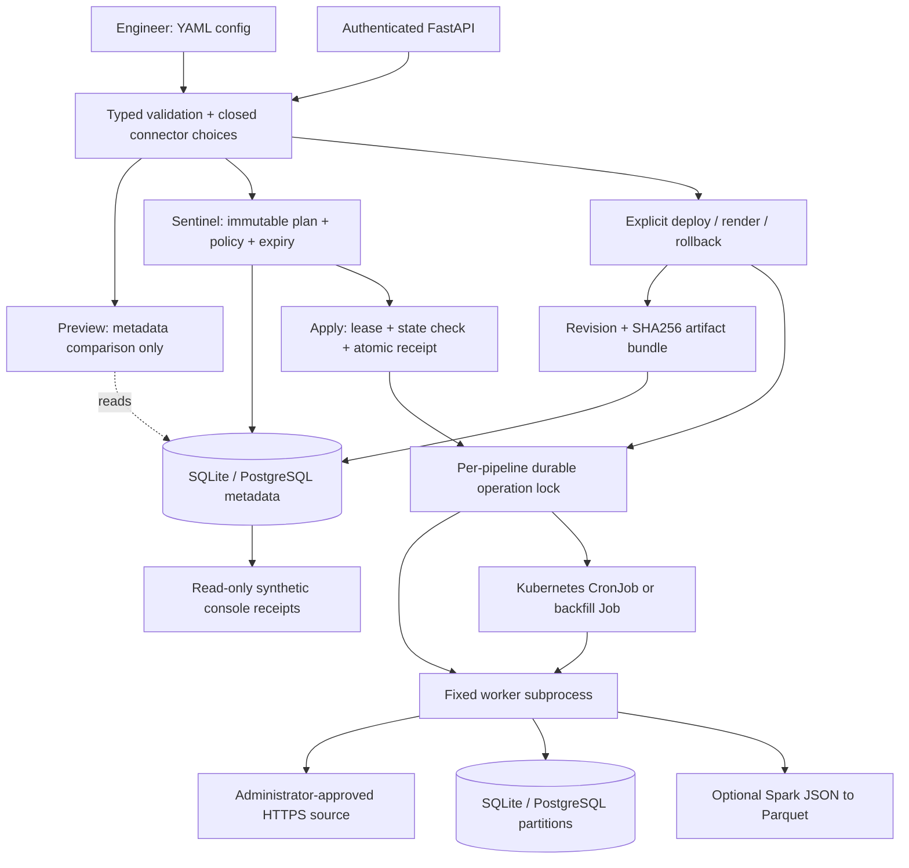

# PipeFoundry

**Sample rehearsal:** `/workbench/rehearsal` runs the actual SQL order transform
against your bounded pasted JSON, with row diagnostics, duplicate winner lineage,
per-currency totals and fingerprinted exports. Samples start blank; no connector
is fetched or output written. Optionally load 100 real retained NYC taxi fare
observations with source date, byte fingerprints and explicit mapping provenance.
Download canonical configuration and the actual
rendered Kubernetes bundle, then continue to release review.
[Workflow, API and limits](docs/sample-rehearsal.md).

**Latest portfolio verification (5 Nov 2026):** PipeFoundry's real Gemini 3.1 inference and automatic 3.5-to-3.1 recovery were verified on public HTTPS; DataGuard uses the healthy free 3.1 pool. [Live proof, restored configuration, all-app retests and account blocker](docs/backup-live-verification.md).

**Earlier AI recovery release (5 Nov 2026):** Shared transient retries, deadline checks and correct provider cooldowns are deployed. [Hosted test receipts, live retests, free-model fallback scope and GitHub account blocker](docs/ai-recovery-release.md).

**Earlier hosted build-gate release (5 Nov 2026):** 126 tests passed, 23 explicit optional skips on the actual Linux builder. Every release image depends on a successful verification receipt. [Build logs, public retests and exact GitHub/AWS blockers](docs/free-hosted-ci.md).

[OpenFX readiness audit](https://github.com/9059Rohith/settlement-recon/blob/main/docs/openfx-interview-readiness.md) · [Interview demonstration](docs/requirements.md)

The public [Release review workspace](https://rohith-pipefoundry.vercel.app/workbench/review)
now audits the actual server-rendered ConfigMap/CronJob from your typed editor draft.
Inspect 12 selected controls with exact field evidence, capture or paste a validated
baseline, compare resource/schedule/data-flow changes, and export a review JSON with
a SHA-256 fingerprint plus the exact reviewed YAML. No AI quota is consumed.

This is static project policy review, not full PSS certification or cluster admission.
Unknown configuration fields and unsafe paths are rejected. Baselines are browser-session
data; both versions are rendered by the current server, not read from live cluster state.
See [research and design](docs/release-review-design.md) and run
`python scripts/benchmark_review.py --samples 30` for a bounded local measurement.

The dated Kubernetes run exercised guarded create, update and rollback on
a disposable K3s cluster. Three Jobs wrote verified SQLite output from
published NYC taxi fares. [Kubernetes execution proof](docs/kubernetes-release-proof.md).

**Release Sentinel binds a reviewed pipeline plan to exact recorded state, then reserves one auditable execution under a durable lease.**

[Live workbench](https://rohith-pipefoundry.vercel.app) · [Public AI demo](https://rohith-pipefoundry.vercel.app/workbench/agent) · [Pipeline editor](https://rohith-pipefoundry.vercel.app/workbench/editor) · [Workbench guide](docs/workbench.md) · [Source](https://github.com/9059Rohith/pipefoundry)

A data engineer should not have to hand-edit a CronJob, Helm chart and scheduler DAG every time an ingestion schedule changes. An operator should be able to identify which configuration ran, replay specific dates, and recover a previous configuration without losing the evidence of what happened. PipeFoundry implements that workflow with typed YAML, fixed Python workers, real SQL writes and versioned deployment artifacts.

The public workbench has fifteen useful pages for actual GitHub repository and workflow inspection, pipeline authoring, server validation, manifest export, deployment previews, security controls, session audit and integration status. Public execution history comes from GitHub Actions. Draft configuration is explicitly unexecuted. The legacy synthetic demonstration receipts at `/demo` and `/demo/console` require authentication, as do all executor and release mutations. The default **public AI demo needs no sign-in or operator token** and uses **Gemini 3.5 Flash-Lite** on a billing-disabled free-tier project. It can inspect only this project's public repository and returns real GitHub source traces. Persistent PostgreSQL allowances limit each visitor to 3 requests per 10 minutes and the whole demo to 2 per minute / 30 per day. A database outage closes the public demo with 503 before inference. Provider keys stay on the server; no paid fallback exists. The separate authenticated agent and OpenAI adapter remain available for explicitly configured operators.

**Real hosted AI verified on 2026-11-02 IST:** HTTP 200, Gemini `gemini-3.5-flash-lite`, one `inspect_github(repository)` call and an answer identifying `main` / Python with a source link. Unauthenticated AI calls still return 401. The AI change passed **77 tests**, with 23 optional integration skips; the earlier PostgreSQL/Spark/container evidence below retains its separate scope. [Hosted AI evidence](evidence/gemini-hosted-verification.json).

GitHub inspection uses a shared PostgreSQL cache, refresh lease, conditional requests and a provider-wide cooldown. Repository metadata, workflows, runs, releases, commits and 26 run-job responses have genuine dated cold-start captures. Evidence can remain readable for at most 24 hours after validation, with original observation times and explicit stale notices. Actual empty collections and failed runs remain visible. [Rate-limit recovery and verification](docs/github-rate-limit-recovery.md) · [Capture provenance](docs/github-evidence-capture.md).

**Public demos verified 5 November 2026:** all 31 GitHub views returned HTTP 200 through the shared PostgreSQL cache during real upstream rate limiting. All four portfolio apps passed mobile/desktop workflows and public AI calls without operator tokens. [Deployment and verification evidence](docs/public-release-20261105.md).



The industrial blueprint design adds 24 original technical plates across
all 16 views, a three-step overview and native scroll motion that respects
reduced-motion preferences. [Design and browser checks](docs/blueprint-design.md) ·
[Artwork inventory](docs/blueprint-assets.md).

The developer workbench now has a connected configuration → validation → artifact → plan journey, a numbered syntax-highlighted editor with real inline validation, manifest copy/download, searchable records and inspection dialogs, a keyboard command palette, a focus-managed mobile menu, and safely formatted AI answers with dated source evidence. [Design and verification](docs/ui-redesign.md).

The expanded 2026-11-01 verification passed **94 host tests** with real PostgreSQL, HTTPS ingestion and fresh minimal-container checks enabled. Three skips comprise two PostgreSQL-only cases under SQLite fixtures and host Spark, which passed separately in Linux: two JSON rows became two verified Parquet rows across EUR/USD partitions. The installed Linux package passed **92 tests** against a separate local PostgreSQL database. Ruff, JavaScript syntax, Bandit, wheel packaging and a pinned dependency audit also passed. Browser checks exercised draft save → server validation → actual YAML download at desktop and mobile sizes. Public HTTPS checks verified real repository inspection, manifest validation and authentication on legacy receipts. These results do not claim a passing hosted CI run or a newly scanned container image. See [current integration evidence](evidence/workbench-integration-summary.json) and the [workbench guide](docs/workbench.md).

## Release Sentinel signature

`plan` freezes canonical config/executor, exact latest revision/status/artifacts, worker and renderer source identity, operator-setting identity, expiry, operation and rollout budgets in an authenticated immutable metadata record. `apply` accepts its opaque identity and an idempotency key. It acquires the same durable lease used by legacy lifecycle commands, checks the frozen state, atomically reserves the receipt and revision, then retains exclusivity through rendering and execution without holding a database transaction. Editing a review file, replaying a consumed plan with another key, changing settings or applying an obsolete plan cannot launch another worker.

```powershell
pipefoundry plan examples/orders-local.yaml --allow-operation create --max-input-rows 3 > release.json
# Review operation, exact expected state, expiry, identities and deterministic risk reasons.
pipefoundry apply release.json --idempotency-key orders-release-20261030
pipefoundry receipt orders-release-20261030
```

The policy covers declared CPU/memory requests, a conservative input-row bound and exactly one current partition (zero backfill partitions). Dynamic sources use the worker's 10,000-row bound instead of a fabricated estimate. Guarded Kubernetes releases require a digest-pinned operator image and report API admission rather than workload completion. Code/operator/template changes cause an update even when pipeline YAML is unchanged; older revisions without runtime identity are conservatively updated once.

Successful and failed receipts are terminal: a retry returns the recorded result even after the plan expires. An interrupted attempt stays `executing` and cannot automatically relaunch. After stopping the original controller **and** worker and inspecting output, an operator can close it using `recover-release KEY --confirm-worker-stopped`, then review a new plan. This is at-most-once launch reservation, not a distributed exactly-once guarantee for external systems. See the [threat model, recovery walkthrough and evaluation](docs/release-sentinel.md).

Creating any Sentinel plan permanently disables the synthetic demo's age-based lease reclamation for that pipeline name. A paused release controller keeps exclusivity even before receipt reservation. Recovery requires a trusted operator to stop the controller and worker; confirmation is an assertion, not machine proof. Legacy lifecycle endpoints remain available and need gateway/RBAC restrictions if all releases must use Sentinel.

Sentinel is deployed and verified over public HTTPS: actual fixture execution, retry receipt identity and no duplicate revision. [Protected feature proof](evidence/signature-public-feature.json).

## Five more things to inspect

1. **A deployment preview with no execution effects.** `preview` validates the same configuration and hosted output rules as deploy, compares canonical configuration and executor to the latest recorded revision, and returns `create`, `update` or `no-op`. It reads metadata without creating revisions, acquiring locks, restoring artifacts or touching workloads. Change output contains bounded field paths and fingerprints; it never returns configuration values or environment credentials.
2. **A real ingestion boundary.** The fixed Python worker normalizes currencies, retries bounded transient HTTPS failures and atomically upserts SQL rows with quality checks. The `(partition_date, id)` key makes repeated SQL partitions idempotent. URLs, credentials, container images and arbitrary programs cannot be supplied in pipeline YAML.
3. **Recoverable control-plane state.** SQLite supports local use; PostgreSQL persists revisions, audit, cross-instance operation locks, artifact bytes and bounded logs for ephemeral hosting. A cold instance can recover and verify SHA256 artifacts before executing backfill or rollback. Preview works from metadata alone even with an empty scratch directory.
4. **A lifecycle that preserves failure evidence.** Backfill accepts 1–31 inclusive UTC dates. Rollback deploys an old configuration as a new revision; teardown retains data and audit. Kubernetes target namespaces are recorded before apply, so later local/render revisions cannot hide an earlier partial cluster deployment from cleanup.
5. **One specification, reviewable delivery files.** Rendering generates a Kubernetes ConfigMap/CronJob, Helm chart, Airflow 3 DAG, canonical config and checksums. Worker pods have no API token, run without root or capabilities, and receive resource/deadline limits. Python and optional Spark runtimes are separate; the minimal API image excludes Java, shell and package managers.

## Architecture and change workflow



`rendered` means files were generated. `succeeded` means the local worker exited successfully. `deployed` means the Kubernetes API accepted a CronJob; a scheduled execution still needs observation. Airflow is an alternative scheduler using a generated artifact. The local executor runs once and does not start a scheduler.

## Reproduce the local workflow

Use Python 3.12+ and a fresh state directory. PowerShell commands are shown; on Linux use `.venv/bin/python` and `.venv/bin/pipefoundry`. The separately tested minimal container pins Python 3.15.

```powershell
python -m venv .venv
.venv\Scripts\python -m pip install -r requirements-dev.lock
.venv\Scripts\python -m pip install --no-deps -e .
$pf = '.venv\Scripts\pipefoundry'
& $pf --state-dir .runtime/walkthrough validate examples/orders-local.yaml
& $pf --state-dir .runtime/walkthrough preview examples/orders-local.yaml # create
& $pf --state-dir .runtime/walkthrough deploy examples/orders-local.yaml  # revision 1
& $pf --state-dir .runtime/walkthrough preview examples/orders-local.yaml # no-op
```

Change the schedule in a copy and review it before running anything:

```powershell
(Get-Content examples/orders-local.yaml -Raw).Replace('0 * * * *', '30 2 * * *') |
  Set-Content .runtime/orders-changed.yaml
& $pf --state-dir .runtime/walkthrough preview .runtime/orders-changed.yaml
# action: update; changes: [{path: config.schedule, kind: changed}]
& $pf --state-dir .runtime/walkthrough deploy .runtime/orders-changed.yaml # revision 2
& $pf --state-dir .runtime/walkthrough backfill orders-demo --start 2026-01-01 --end 2026-01-03
& $pf --state-dir .runtime/walkthrough rollback orders-demo --revision 1  # new revision 3
& $pf --state-dir .runtime/walkthrough status orders-demo
& $pf --state-dir .runtime/walkthrough logs orders-demo
& $pf --state-dir .runtime/walkthrough audit orders-demo
& $pf --state-dir .runtime/walkthrough teardown orders-demo
```

The fixture has three orders totaling 4,250 cents. Replaying one SQL date retains three rows for that date; the walkthrough adds three historical partitions. Rollback restores configuration and executes it; it does not reverse previously committed data. Re-running the walkthrough on the same state directory advances revision numbers, so use a fresh directory for the annotated revision IDs.

## Preview contract

CLI: `pipefoundry [--state-dir PATH] preview CONFIG [--executor local|kubernetes]`.
API: authenticated `POST /deployments/preview` with the same `{config, executor}` envelope as deployment. Success is HTTP 200; invalid configuration is 422 with a sanitized error. Missing/wrong credentials are 401; an unconfigured/short server token returns 503.

The authenticated `/openapi.json` schema exposes a typed `DeploymentPreview` response, including the action enum, permitted change paths, fingerprint format and twelve-change bound.

```json
{
  "name": "orders-demo",
  "action": "update",
  "current": {
    "revision": 1,
    "status": "succeeded",
    "executor": "local",
    "fingerprint": "<sha256 of canonical recorded specification>"
  },
  "desired_fingerprint": "<sha256 of canonical submitted specification>",
  "changes": [{"path": "config.schedule", "kind": "changed"}],
  "changes_truncated": false,
  "operation_in_progress": false,
  "comparison": "latest recorded revision; no live drift or environment check"
}
```

Defaults are expanded, object key order is ignored and cron whitespace is normalized. At most twelve known field changes are returned in stable order. No-op requires equal specification/executor, a latest `succeeded`/`deployed` revision, and no observed active operation. A failed, torn-down, rendered or unfinished revision requires an update even when its configuration matches. A new pipeline reports `create`; an existing lease is still reported through `operation_in_progress`.

This is an advisory metadata snapshot. It does not inspect the live cluster, prove credentials/network capacity, compare operator image/namespace/environment changes, or reserve a revision. Another operator can deploy after the comparison. Semantically equivalent but differently spelled cron expressions can still compare as changed. Explicit `deploy` retains its behavior of creating and executing a new revision even after a no-op preview. `render` also creates durable revision/audit records; use `preview` for a comparison without those writes. First opening a local platform initializes its empty metadata database.

## Authenticated API and Compose

Docker Desktop/Engine is required for this path. Generate local credentials; the Compose file requires both values.

```powershell
$env:POSTGRES_PASSWORD = (.venv\Scripts\python -c "import secrets; print(secrets.token_hex(24))")
$env:PIPEFOUNDRY_API_TOKEN = (.venv\Scripts\python -c "import secrets; print(secrets.token_hex(32))")
docker compose up --build -d --wait
$headers = @{Authorization = "Bearer $env:PIPEFOUNDRY_API_TOKEN"}
$spec = (& $pf validate examples/orders-local.yaml | ConvertFrom-Json).config
$body = @{config=$spec; executor='local'} | ConvertTo-Json -Depth 8
Invoke-RestMethod http://localhost:8094/deployments/preview -Method Post -Headers $headers -ContentType application/json -Body $body
Invoke-RestMethod http://localhost:8094/pipelines -Method Post -Headers $headers -ContentType application/json -Body $body
```

API port 8094 and PostgreSQL port 55435 bind to localhost. For direct development, set the token and run `.venv\Scripts\python -m uvicorn pipefoundry.api:app --host 127.0.0.1 --port 8094`. Credentials belong in environment/secret storage, never YAML.

| API | Result |
|---|---|
| `POST /deployments/preview` | Compare `{config, executor}` without execution or durable lifecycle writes |
| `POST /releases/plan` | Freeze `{config, executor, policy, ttl_seconds}` in immutable authenticated metadata |
| `POST /releases/apply` | Apply `{plan_id, digest, idempotency_key}` under the pipeline lease |
| `GET /releases/receipts/{key}` | Observe durable `executing`, `succeeded` or `failed` receipt |
| `POST /releases/recover` | Close interrupted receipt with `{idempotency_key, confirm_worker_stopped: true}` |
| `POST /pipelines` | Deploy `{config, executor}`; HTTP 201 |
| `POST /render` | Render bare config as a new durable revision; HTTP 201 |
| `GET /pipelines`, `GET /pipelines/{name}` | Latest recorded state; individual status also queries outstanding cluster targets |
| `GET /pipelines/{name}/logs`, `/audit` | Bounded actual worker/cluster logs and lifecycle events |
| `POST /pipelines/{name}/backfill` | `{start, end}` inclusive UTC dates |
| `POST /pipelines/{name}/rollback` | `{revision}` creates a new deployment revision |
| `DELETE /pipelines/{name}` | Delete recorded cluster workloads; retain revisions, audit and output data |

## What runs where

| Capability | Public deployment | Reproducible local execution | Artifact / external prerequisite |
|---|---|---|---|
| Synthetic ingestion, quality, two backfills and rollback | Legacy receipts require authentication | CLI/Compose worker and SQL tests | Public workbench uses real GitHub execution history |
| Preview and lifecycle API | Authenticated operator routes | CLI and API tests, including cold-root PostgreSQL | Preview verified over public HTTPS; see [feature proof](evidence/review-public-feature.json) |
| Approved HTTPS → PostgreSQL | Connector available to the operator | Ephemeral TLS server → real subprocess → PostgreSQL acceptance test | An actual upstream URL/CA/allowlist and DSN are operator settings |
| Spark JSON → partitioned Parquet | Excluded from the minimal API image | Separately verified Linux Spark container | Java 17+ and optional locked Spark dependencies |
| Kubernetes / Helm | No hosted cluster execution | Generated artifacts and external-tool boundary tests | Real cluster, namespace, PVC, secrets, kubectl and worker image required |
| Airflow 3 DAG | No hosted scheduler | Actual generated DAG, PythonOperator and PySpark over 1,000 public NYC fares | Airflow 3.3.2 local Dag.test; [execution proof](docs/airflow-spark-proof.md) |
| AWS EKS infrastructure | No AWS provisioned | Terraform validation / IaC scans recorded | AWS account, remote state and VPC-connected administrator runner |

For HTTPS ingestion, use [orders-postgres.yaml](examples/orders-postgres.yaml) and set `PIPEFOUNDRY_ORDERS_URL`, `PIPEFOUNDRY_ALLOWED_HOSTS` and `PIPEFOUNDRY_POSTGRES_DSN`. TLS verification is mandatory, redirects and URL credentials are rejected, responses are bounded to 1 MiB/10,000 records, and transient retries stop after three attempts. For Spark, see [orders-spark.yaml](examples/orders-spark.yaml), [Dockerfile.spark](Dockerfile.spark) and the [verification notes](docs/verification.md).

`pipefoundry render examples/orders-local.yaml` creates the deployment bundle. To apply it through the trusted CLI, set `PIPEFOUNDRY_NAMESPACE` and `PIPEFOUNDRY_WORKER_IMAGE`, provision prerequisites, then use `deploy CONFIG --executor kubernetes`. Read the [runbook](docs/runbook.md), [Helm chart](infra/helm/pipefoundry) and [Terraform prerequisites](infra/terraform/README.md) first. The API image intentionally has no kubectl or cluster credentials.

## Measured work and latency

The committed [benchmark samples](evidence/preview-benchmark.json) measure real sequential wall time on Windows 11 / Python 3.12.14 with local SQLite, three fixture rows and worker process startup. Three validation/template warmups and one full deployment precede measurements. The shared workstation was running other verification work. These results establish local reproducibility, not a throughput or cloud latency promise.

Preview's 100 reads were remeasured after the single-statement snapshot fix; the unchanged stages retain their full-run samples. Both timestamps and the remeasurement scope are recorded with the raw samples. Changes in workstation contention prevent attributing timing differences to the SQL change alone.

| Operation | Samples | Median ms | Minimum–maximum ms |
|---|---:|---:|---:|
| validate | 100 | 0.0926 | 0.0857–1.0343 |
| template | 100 | 0.0165 | 0.0155–0.1208 |
| render | 100 | 99.4455 | 63.4029–642.7722 |
| preview | 100 | 4.6419 | 3.1926–9.6117 |
| local_execution | 30 | 2448.5092 | 1735.6929–3356.4455 |

The 11-line authored example generates **8 files / 345 lines**, including duplicated standalone, bundle and Helm workload forms plus checksums. This counts generated material, not unique logic, human hours saved or a measured speedup over manual authoring. Preview performs zero lifecycle writes and worker launches; deployment performs a real revision render and subprocess execution. Reproduce timings with:

```powershell
.venv\Scripts\python scripts/benchmark.py --samples 100 --execution-samples 30 --output evidence/preview-benchmark.json
```

## Security and operational tradeoffs

Configuration is data, never code. Typed allowlists reject unknown fields, arbitrary SQL/scripts/URLs, traversal/absolute paths, unsupported connectors and excessive requested resources. Secrets and network destinations are administrator-owned. API body size is limited to 32 KiB and upload time to five seconds. Protected routes check authentication before consuming untrusted bodies. Preview validation errors do not echo pasted input; its change list intentionally omits before/after values. Public validation renders in memory without creating platform revisions. Public GitHub reads use a fixed API host, safe repository names and no server credentials. The workbench uses self-hosted scripts and styles under a restrictive CSP. Tokens entered in authenticated workbench forms are cleared after each request and never saved in browser storage.

SQL batches and quality checks commit atomically. A per-pipeline database lock coordinates separate instances, but a crashed ordinary operation requires operator reconciliation; only the reserved demo seed has constrained lease recovery. Worker output and durable artifact storage are bounded. Local subprocesses have deadlines but no OS resource sandbox; apply Docker limits for host isolation. Multi-tenant identity/RBAC, a distributed work queue, automatic ordinary-operation recovery, schema migration management and a production lakehouse commit protocol remain outside this implementation.

The control API is synchronous. Each worker/date can consume up to five minutes, so an asynchronous job queue is the next production scaling boundary. Kubernetes `Forbid` protects scheduled jobs but does not serialize manually created backfill Jobs. Spark partition overwrite needs reader coordination. SHA256 protects accidental/tampered artifact changes relative to trusted metadata; it is not a signature against an attacker controlling both stores. Use TLS verification, least-privilege roles, backups and provider edge rate limits. See [security](docs/security.md), [hosted durability](docs/hosted-profile.md) and [failure recovery](docs/runbook.md).

## Verification and reviewer guide

```powershell
.venv\Scripts\python -m pytest -q
.venv\Scripts\python -m ruff check src tests scripts
.venv\Scripts\python -m ruff format --check src tests scripts
.venv\Scripts\python -m bandit -r src
```

Real PostgreSQL tests opt in with `PIPEFOUNDRY_POSTGRES_DSN`; Spark and container identity tests have separate runtime opt-ins. [Verification](docs/verification.md) records exact commands, passing counts, skips and historical evidence. GitHub Actions is configured but execution is blocked by an account-level runner restriction; no hosted CI pass is claimed. The preview revision was verified locally and over the public production hostname, including no-op/update behavior and unchanged durable audit history. Public-hosting, image scans and earlier Spark results are dated evidence with their own scope.

For a focused code review or interview discussion:

| Follow this path | Question it answers |
|---|---|
| [Preview tests](tests/test_preview.py) → [engine](src/pipefoundry/engine.py) | How do you compare desired state without accidentally executing it? What can race after preview? |
| [Models](src/pipefoundry/models.py) → [workloads](src/pipefoundry/workloads.py) → [worker](src/pipefoundry/worker.py) | Where do config, network, SQL transaction and process trust boundaries sit? |
| [Durable metadata tests](tests/test_durable_metadata.py) → [metadata adapter](src/pipefoundry/metadata.py) | What survives an empty filesystem, concurrent instances or interrupted work? |
| [Cluster boundary tests](tests/test_cluster_boundary.py) → [render](src/pipefoundry/render.py) | What does API acceptance prove, and why track original namespaces separately? |
| [Architecture decisions](docs/architecture.md) → [runbook](docs/runbook.md) | Which failures need retry, rollback, data restoration or explicit reconciliation? |

Useful next exercises are adding an asynchronous operation receipt, an optimistic revision precondition on deploy, an actual on-cluster NetworkPolicy denial test, and a manifest-based atomic publish protocol for object storage. Each addresses a stated boundary rather than expanding the technology list.

The current operational feature also has [actual public HTTPS verification](evidence/review-public-feature.json) and a [fresh all-severity runtime image scan](evidence/signature-image-scan.json). These complement the dated local experiments; they do not establish a production SLA.

Current signature release: [actual protected HTTPS checks](evidence/signature-public-feature.json), [all-severity runtime scan](evidence/signature-image-scan.json), and [measured code changes](evidence/signature-code-metrics.json). Application, test and operational-script lines are counted separately; documentation, comments and docstrings are excluded.

### OpenFX execution and release verification

The generated Airflow/PySpark DAG and both independent readbacks are documented with their public source capture. The later PostgreSQL-backed full suite passed 126 tests with four documented skips, and the production release passed public manifest-review and request-boundary checks. [Execution, tests, and production evidence](docs/airflow-spark-proof.md)
