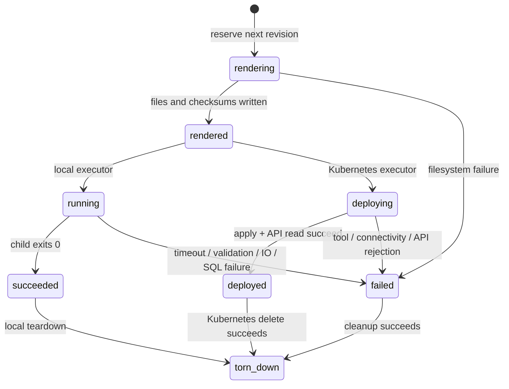

# Architecture and decisions

PipeFoundry separates *specification*, *revision*, *deployment observation* and
*data effect*. Config validation has no external effects. Rendering writes
versioned artifacts. Local deployment runs a fixed worker process and marks
success only after exit zero. Kubernetes deployment applies a bundle and reads
the CronJob from the API server; acceptance is recorded independently of job
success. Live status returns last schedule/success timestamps and active jobs.

Revision numbers are monotonic per pipeline. SQLite `BEGIN IMMEDIATE` reserves
them atomically. An `operations` table rejects overlapping mutations across
separate CLI/API instances; an in-process lock also serializes request threads.
Locks are deliberately not auto-expired: killing a deployment process can leave
an external operation running, so an operator must inspect before recovery.
Every successful/failed deploy, backfill, rollback and teardown is audited.
Rejected preflight/config requests do not reserve a revision or lifecycle event;
the reverse proxy should record request authentication/validation failures.

Kubernetes resource targets are persisted separately from the latest artifact:
the pipeline name, original namespace and last attempted revision are recorded
before apply. An unsuccessful apply may have created resources, so its target
remains outstanding. A later render, local deployment, failed revision or changed
namespace environment cannot erase earlier targets. Status exposes these
`cluster_targets`; live observations and logs use the recorded namespaces.
Teardown deletes pipeline-labelled objects in every outstanding namespace and
clears each target only after its delete succeeds. A partial deletion can be
retried without losing the remaining target or claiming full teardown success.

The metadata database stores the digest of a checksum manifest, which in turn
hashes every generated artifact. Before execution or rollback, the platform
validates the manifest and every file. A local disk administrator can replace
both the database and artifacts; this is integrity detection, not cryptographic
attestation against a privileged attacker. Back up both together.

## ADR 001: closed connector and transformation vocabulary

**Decision:** accept a small typed spec and fixed workload functions, never
uploaded scripts, SQL, templating expressions, URLs or image names.

**Why:** user-supplied execution and network addresses make a deployment service
a remote code execution/SSRF surface. Administrator environment configuration
owns actual network destinations and image selection. Additional connectors
require reviewed package code and negative/integration tests.

**Tradeoff:** fewer transformations than a general orchestrator. This sample is
an onboarding deployment platform, not a replacement for arbitrary DAG authoring.

## ADR 002: SQLite metadata and genuine local executor

**Decision:** use SQLite WAL plus bounded Python subprocesses for a runnable
single-operator platform. PostgreSQL is the production sample data sink.

**Why:** a reviewer can prove execution, idempotence and rollback without cloud
credentials or a cluster. The API never mocks success when tools are absent.
Connections close deterministically to support Windows and limit handles.

**Tradeoff:** one API replica, local filesystem persistence and no durable
distributed work queue. A five-minute worker blocks that request's thread;
backfills can take up to 31 sequential workers. Production scale needs a task
queue, per-tenant identities, quotas and durable run-level state before adding
horizontal replicas. A failed backfill commits prior completed dates and records
failure; retrying is safe for the SQL workload due to partition-key upserts.

## ADR 003: immutable deployment bundles and forward rollback

**Decision:** every deployment has a versioned JSON config, YAML objects, Helm
chart, Airflow DAG and checksum manifest. Rollback revalidates the old config and
creates a new revision with a new audit event.

**Why:** history is preserved, and a rollback itself can be observed and reverted.

**Tradeoff:** rollback restores *pipeline configuration* using the current
administrator-selected worker image. It does not reverse rows, restore old data,
or restore external infrastructure/image versions. SQL transaction failures roll
back their own batch; data recovery requires database backups/PITR. Git-version
and digest-pin the worker image when reproducible historical runtime is needed.

## ADR 004: scheduler-specific artifacts

**Decision:** Kubernetes CronJob is the default production scheduler. Airflow
3.3.2 with its standard provider is emitted as an alternative for organizations already operating it.

**Why:** CronJobs directly represent bounded periodic ingestion. Both use the
same validation and fixed worker code. The local executor remains a one-shot
executor and deliberately makes no scheduling promise.

**Tradeoff:** alternative schedulers require their own runtime acceptance tests.
Never install both for the same pipeline/date without understanding duplicate
execution and external API rate limits. Cron `Forbid` prevents overlap per
CronJob; manual backfill jobs need an operator to coordinate with scheduled runs.

## ADR 005: private EKS control plane

**Decision:** the Terraform EKS API has no public endpoint; CI deployment uses an
explicitly selected VPC-connected runner and OIDC role.

**Why:** cloud credentials alone should not expose the cluster management API to
the internet. Worker nodes have no public IPs, require IMDSv2, and separate CNI
permissions through IRSA. Workload pods receive no service-account token.

**Tradeoff:** a laptop/GitHub hosted runner cannot deploy until private network
access is established. NAT, EKS, nodes, disks and logs cost money. The module is
validated configuration, not evidence of a provisioned AWS cluster.

## Data contracts

Orders contain bounded ASCII identifiers, nonnegative integer cents and
three-letter currencies. Python normalization uses last-observed duplicate ID
within a response; SQL deduplicates by `(partition_date, id)`. PostgreSQL checks
and upserts run in one transaction with connection/statement timeouts. Spark
rejects duplicate IDs to avoid nondeterministic distributed last-row ordering.
Parquet is partitioned by normalized currency under a date-specific directory.

SQL sinks preserve existing rows absent from a later source response. This is
an upsert feed, not a full snapshot reconciliation. Define delete/tombstone
semantics before applying it to a snapshot API. The sample data contract uses
cents to avoid float rounding; multi-currency totals are only a fixture sanity
check, not a valid financial aggregation.
